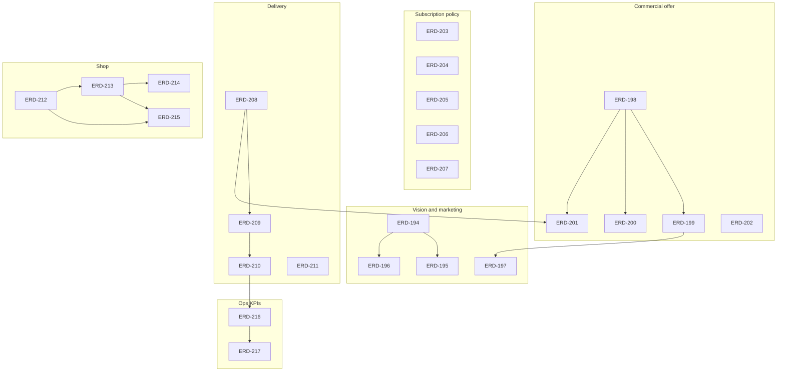

# Fred × Erdgut product backlog

This document indexes **[erdgut-fred-product-backlog.csv](erdgut-fred-product-backlog.csv)** (tickets **ERD-194**–**ERD-219**). The CSV uses the same columns as [erdgut-mvp-tickets.csv](../erdgut-mvp-tickets.csv). Status defaults to **Backlog** until work starts.

## Purpose

- Trace every item from the Fred × Erdgut Notion plan (vision, box offer, delivery, subscription rules, shop UX, ops KPIs) to a ticket.
- Avoid duplicating completed MVP work: cross-reference [erdgut-mvp-tickets.csv](../erdgut-mvp-tickets.csv) (especially **ERD-169–183**, **ERD-178**, **ERD-185–193**).
- Give engineers a single **Acceptance Criteria** pattern per ticket (see below).

## Acceptance criteria template

Each row’s **Acceptance Criteria** column in the CSV follows this structure:

| Section | Meaning |
|--------|---------|
| **Add** | New behaviour, routes, fields, copy, or admin surfaces. |
| **Remove** | Behaviour or UI to delete (or `N/A`). |
| **Replace** | Swaps (e.g. unlimited skip → policy-driven skip). |
| **Out of scope** | Explicit non-goals to prevent scope creep. |
| **Verification** | Tests (`php artisan test`), manual checks, or route names from [UX-ERD-168-baseline.md](UX-ERD-168-baseline.md). |

## Cross-reference: existing MVP tickets

| Area | Fred tickets | Related completed / backlog MVP tickets |
|------|----------------|----------------------------------------|
| Marketing depth (Terroirs) | ERD-194–197, ERD-195, ERD-196 | **ERD-168** baseline; **ERD-169** home UX; **ERD-170** about; **ERD-171** producers |
| Box & billing truth | ERD-198–202 | **ERD-189** billing model; **ERD-190–193** planner & charges |
| Subscription UX | ERD-203–207 | **ERD-175** subscription management UX |
| Deliveries & gift | ERD-204, ERD-207 | **ERD-176** deliveries UX |
| Shop PDP & catalog | ERD-212–215 | **ERD-178** shop UX; **ERD-161** admin product CRUD |
| Admin KPIs | ERD-217 | **ERD-185** overview KPIs; **ERD-187** operational browser |

When implementing a Fred ticket, **read the related MVP ticket** to avoid redoing layout-only work already scoped there.

## Notion plan → ticket mapping

### Vision & editorial (Terroirs-style, general information)

| Notion / Fred idea | Ticket(s) |
|--------------------|------------|
| General outlook, who we are, vision | ERD-194, ERD-195, ERD-196 |
| Terroirs-Avenir inspiration (visuals + business model) | ERD-195, ERD-197 |
| Margin story 30% vs 40% market (transparent copy) | ERD-197, ERD-199 |

### Box offer table (Trial, Small, Standard, Big)

| Notion / Fred idea | Ticket(s) |
|--------------------|------------|
| Trial 35€ once; Small 20€; Standard 35€; Big 42€ | ERD-198 |
| Meals / product counts / Big +20% quantity | ERD-198 |
| Target cost & 30% margin | ERD-199 |
| Extra eggs/dairy ~4–5€ | ERD-200 |
| Delivery cost on top | ERD-201 |
| Meat optional / long-run / special producers | ERD-202 |
| Skip policy (strikes, max skip, 6 weeks/year) | ERD-203 |

### Delivery & logistics

| Notion / Fred idea | Ticket(s) |
|--------------------|------------|
| Pickup free vs delivery paid | ERD-208, ERD-201 |
| Zone scheduling (e.g. Neukölln vs P-Berg different days) | ERD-209 |
| Standard routes + max ~10 min detour | ERD-210 |
| Wed–Fri / B2C windows vs restaurant days | ERD-211 |
| KPI data: route runs | ERD-216 |
| KPIs: orders/route, stops/h, cost/delivery, basket, empty km | ERD-217 |

### Subscription & payment

| Notion / Fred idea | Ticket(s) |
|--------------------|------------|
| Weekly payment; optional monthly + 5% discount | ERD-205 |
| Give box to someone / association | ERD-204 |
| Deadlines (prefs, extras, box edit; Wed 23:59 style) | ERD-207 |
| Cancel / pause 1 month notice | ERD-206 |

### Shop inspirations

| Notion / Fred idea | Ticket(s) |
|--------------------|------------|
| Crowdfarming multi-photo PDP | ERD-212 |
| Vinello-style tags (origin, taste, region, producer) | ERD-213 |
| Plattform-style kg/grams quantities | ERD-214 |
| PDP performance & SEO | ERD-215 |

### Research & closure

| Notion / Fred idea | Ticket(s) |
|--------------------|------------|
| HelloFresh / big-box account UX “spy” | ERD-218 |
| Traceability audit of this mapping | ERD-219 |

## Dependency overview

## Workflow

1. Open [erdgut-fred-product-backlog.csv](erdgut-fred-product-backlog.csv).
2. Pick the next **Backlog** row (respect **Depends On**).
3. Branch `feature/erd-XXX-short-slug`, implement, test per [CLAUDE.md](../CLAUDE.md).
4. Set **Status** to `Done` in the CSV in the **same commit** as the implementation (same convention as the MVP ticket file).
5. Deploy via `staging` → `main` as per team Git flow.

## Research output (ERD-218)

When ERD-218 is done, add findings under `docs/research/` (e.g. `hellofresh-account-ux.md`) and link the file path in the ticket Description or here.
